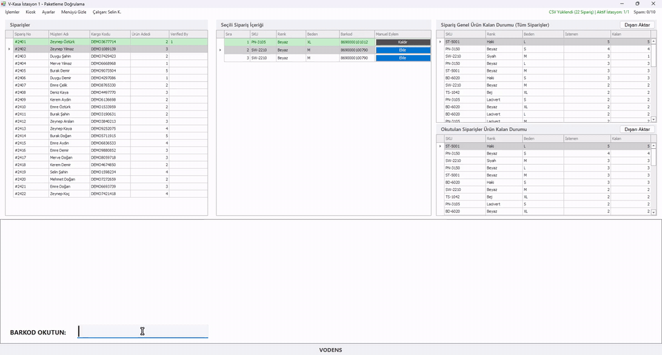
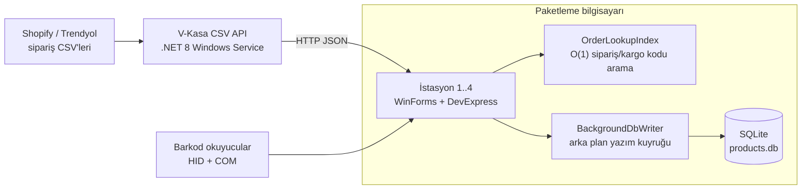
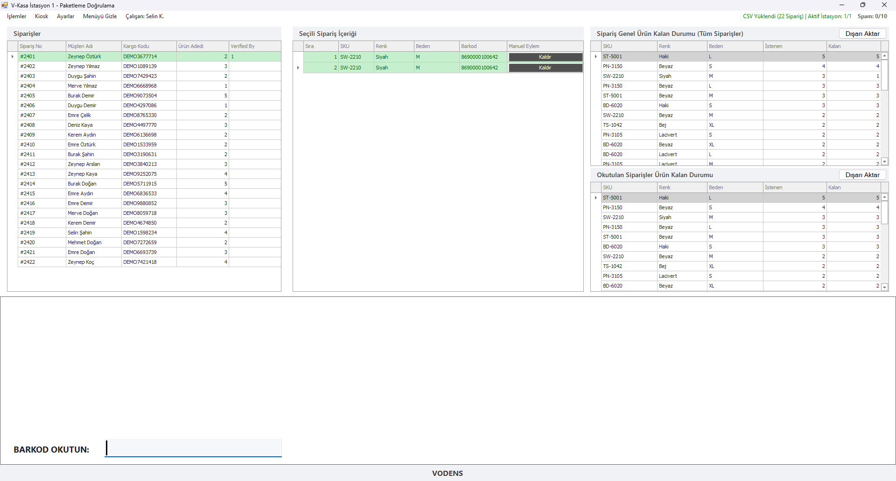
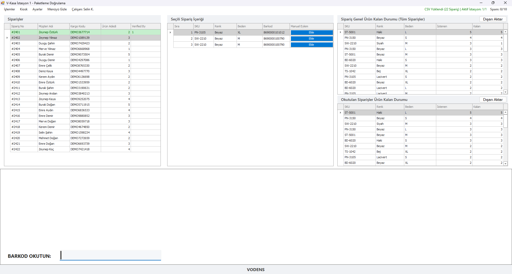
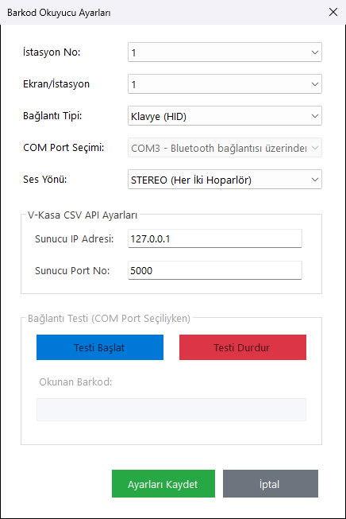
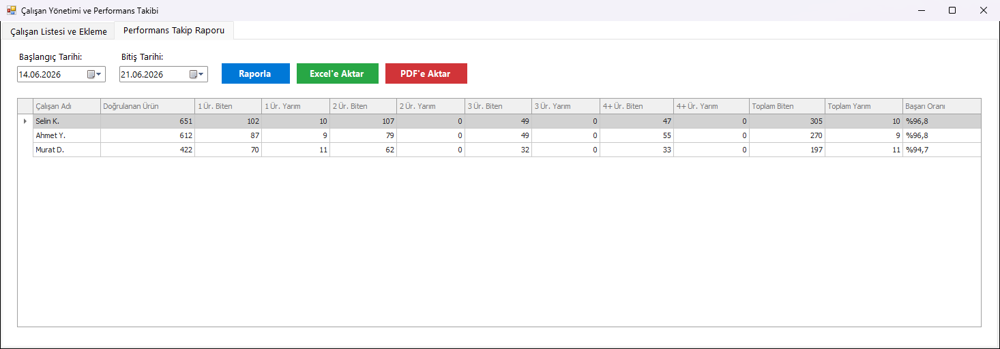

# V-Kasa — Barkod Doğrulamalı Depo Paketleme Sistemi

**Depoda paketlenen her siparişin her ürününü barkodla doğrulatan; yanlış veya eksik ürün gönderimini sistemsel olarak engelleyen çok istasyonlu kiosk uygulaması.**

-informational)

-lightgrey)

> **30 saniyede:**
> - **Problem:** Shopify ve Trendyol siparişleri depoda elle kontrol edilerek paketleniyordu; yanlış beden/renk veya eksik ürün gönderimi iade ve müşteri memnuniyetsizliği demekti.
> - **Çözüm:** Çalışan her ürünü okutur; siparişin **tüm kalemleri doğrulanmadan sipariş tamamlanamaz**. Aynı bilgisayarda 4 ekrana kadar istasyon, istasyonlar arası çakışma koruması, çalışan bazlı performans kaydı.
> - **Kanıt:** Gerçek depo donanımıyla (HID + seri port barkod okuyucular) sahada çalışan sistem; eski/yeni implementasyonu medyan–p95 ile karşılaştıran performans test paketi.

  

<b>English summary</b>

V-Kasa is a warehouse packing-verification kiosk. Packers scan every item with a barcode reader; an order cannot be completed until every line is verified. It runs up to four stations on one PC (one per monitor) with order partitioning so the same order is never packed twice, employee barcode-card sign-in, audio feedback, a kiosk lock mode, employee performance logs, and a separate .NET 8 Windows Service API that distributes order CSVs to packing PCs. Source is private (commercial).

---

## Problem

Paketleme masasında hata maliyeti yüksektir: yanlış ürün = kargo ücreti × 2 + iade işlemi + kötü yorum. Elle kontrol; yoğun saatlerde, yorgun çalışanla ve benzer görünen ürünlerde (aynı modelin farklı beden/renkleri) kaçınılmaz olarak hata üretiyordu. Ayrıca kimin hangi siparişi paketlediği ve ne hızda çalıştığı ölçülemiyordu.

## Çözüm

V-Kasa paketleme sürecini **"önce doğrula, sonra kapat"** kuralına bağlar:

1. Siparişler Shopify/Trendyol CSV'lerinden yüklenir, ürünler Shopify ürün veritabanıyla eşleştirilir.
2. Çalışan kendi **barkod kartını** okutarak oturum açar.
3. Siparişin kargo kodu okutulur → ekranda kalemler listelenir.
4. Her ürün okutuldukça satır doğrulanır; yanlış ürün anında **sesli ve renkli** uyarı verir.
5. Tüm kalemler doğrulanınca sipariş tamamlanır ve çalışan adına kayıt altına alınır.

## Öne çıkan özellikler

- **Çok istasyon, tek bilgisayar:** 1–4 istasyon, her biri ayrı ekranda; siparişler istasyonlara **partition** ile bölüştürülür, aynı sipariş iki istasyonda işlenmez.
- **Donanım entegrasyonu:** HID klavye-wedge ve COM port (seri) barkod okuyucular, okuyucu–istasyon eşleştirme ekranı, Win32 klavye hook'u.
- **Kiosk modu:** Tam ekran, kilitli operasyon; çalışanın uygulama dışına çıkması engellenir.
- **Sesli/renkli geri bildirim:** "okundu / hata / sipariş tamam" sesleri, özelleştirilebilir geri bildirim renkleri.
- **Eşleşmeyen ürün ve manuel doğrulama:** Barkodu olmayan ürünler için çift onaylı elle işaretleme.
- **Kötüye kullanım koruması:** Barkod okutmak yerine art arda manuel doğrulama yapılırsa sayaç devreye girer; 10 ardışık manuel onayda uyarı ekranı açılır — sistemin "kestirme yolla" atlatılması engellenir.
- **Çalışan performansı:** Çalışan bazlı doğrulama istatistikleri ve ürün özet raporları.
- **CSV dağıtım servisi:** CSV'leri üreten makine ile paketleme makineleri ayrı; `.NET 8 Minimal API` Windows servisi siparişleri ağ üzerinden dağıtır.
- **Kurulum otomasyonu:** PowerShell kurulum betikleri (servis kaydı, güvenlik duvarı kuralı, yapılandırma).

## Mimari

## Mühendislik kararları

- **Okutma anında gecikme sıfıra yakın olmalı.** Barkod başına yapılan DB yazımları kullanıcı arayüzü iş parçacığından alınıp FIFO sırası korunan bir **arka plan yazıcıya** (`BackgroundDbWriter`) taşındı.
- **Doğrusal arama yerine indeks.** Sipariş ID ve kargo koduna göre normalize edilmiş sözlük (`OrderLookupIndex`) ile okutmada arama sabit zamanlı hale getirildi.
- **Özet hesaplama debounce.** Ürün özeti her okutmada her istasyonda ayrı ayrı (4 istasyonda 8 kez) hesaplanmak yerine, process genelindeki tek bir koordinatörde ~250 ms içinde gelen istekler birleştirilip bir kez hesaplanır (`SummaryCoordinator`, saf `ProductSummaryCalculator`).
- **Ölçerek optimize etme.** Eski ve yeni implementasyonları aynı veride çalıştırıp medyan/p95 süreleri karşılaştıran performans testleri; eşik aşımında `perf.log`.
- **Sunucusuz veri:** SQLite seçimi; depo ortamında IT altyapısı gerektirmeden 4 istasyonun tek makinede çalışması için.
- **Barkod normalizasyonu:** Farklı okuyucuların ürettiği farklı biçimler tek bir normalizer'dan geçer (birim testli).

## Kalite ve test

| Metrik | Değer |
|---|---|
| Üretim kodu | ~11.800 satır C# |
| Test | 60+ NUnit testi (sipariş DB yöneticisi, indeks, barkod normalizer, çalışan önbelleği, arka plan yazıcı, özet hesaplayıcı) + performans karşılaştırma paketi |
| Dokümantasyon | Kapsamlı HTML destek rehberi (operatörler için) |

## Teknoloji yığını

| Alan | Teknolojiler |
|---|---|
| İstemci | C#, .NET Framework 4.7.2, WinForms, DevExpress 26.1 |
| Servis | ASP.NET Core Minimal API (.NET 8), Windows Service |
| Veri | SQLite (`System.Data.SQLite`), CsvHelper |
| Donanım | HID barkod okuyucu, seri port (9600 baud), `winmm.dll` (ses), `user32.dll` (klavye hook) |
| Test | NUnit |
| Dağıtım | PowerShell kurulum betikleri, zip paketleri |

## Ekran görüntüleri

| | |
|---|---|
|  **Paketleme** — okutulan kalemler |  **Yanlış ürün uyarısı** |
|  **Okuyucu–istasyon eşleştirme** |  **Çalışan / ürün özeti** |

> Görsellerdeki tüm sipariş, müşteri, ürün ve çalışan bilgileri kurgusaldır; uygulama izole bir demo kopyasında sahte veriyle çalıştırılarak çekilmiştir.

## Rolüm

Tek geliştirici: depo sürecinin yerinde gözlemlenmesi, gereksinimler, donanım entegrasyonu, geliştirme, performans iyileştirmeleri, kurulum ve operatör eğitim dokümanı.

## Kaynak kodu hakkında

Bu depo bir **vaka çalışmasıdır**; kod ticari bir işletmeye ait olduğu için paylaşılmamaktadır. Görüşmede canlı demo ve kod incelemesi yapabilirim.

**Paylaşılabilen kısım:** [`ornek-kod/`](ornek-kod) klasöründe asıl projeden alınmış, gizli bilgi içermeyen küçük bir parça var: barkod / sipariş kodu / ürün adı eşleştirmesi için tek geçişli, Türkçe uyumlu normalizasyon. Tek başına derlenir ve birim testleriyle birlikte gelir (`dotnet test`).

📫 **İletişim:** [GitHub profilim](https://github.com/furkan-karapinar)
